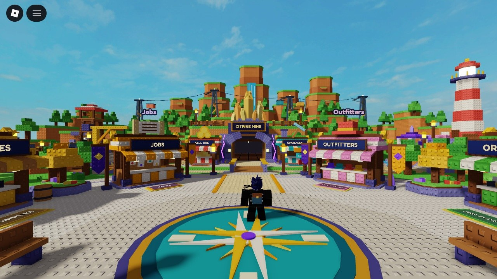
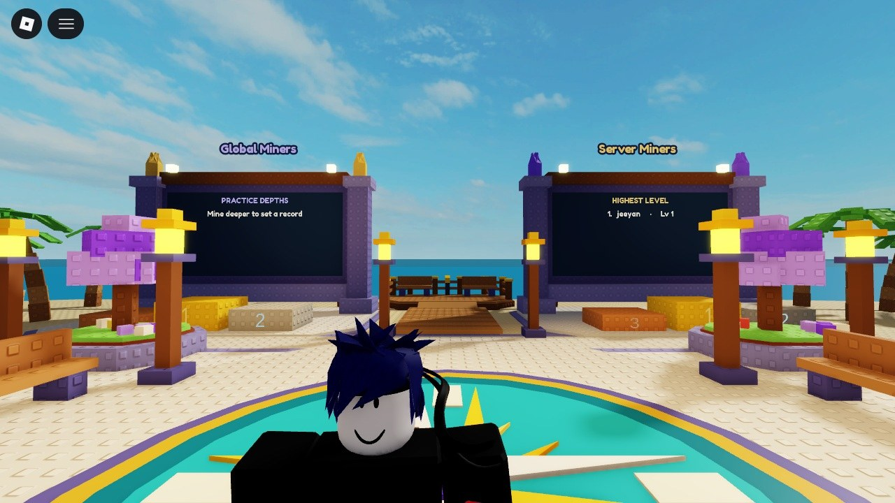

# Mine EVERYTHING!



Citrine Cove is a multiplayer Roblox mining simulator. Aim at a cave wall or floor to highlight a single block, hold through the pickaxe swing, and bring the ore to the harbor. Each block face measures 6 × 6 studs. Every pick takes one block per cut. Speed shortens the cut and Power unlocks harder ore. The starter pack holds eight blocks. Ore grants XP. Each level after the first awards one skill point. [Watch the intro](art/starfall/Where-the-Stars-Took-Root-Current.mp4).

## Play locally

1. Open `build/Mine-Everything.rbxlx` in Roblox Studio, or use the existing **Endless Mining** Studio place connected to this project's Rojo server. To create the build from a fresh checkout, use the commands below.
2. Press **F5**. On a phone or tablet, turn the screen sideways to play. Each visit opens with *Where the Stars Took Root*, a 53-second film photographed at 24 fps. A star breaks into the island, a miner uncovers a trace of it millions of years later, and the cove sees its light come out of the mine, and your avatar walks in and breaks the rock open. When **Break it open** appears, press **Space**, press **X** on a gamepad, or tap the button. The film also completes if you let the prompt pass. Use **Skip**, **Enter**, or gamepad **B** at any time. To watch again, open **Settings → Where the Stars Took Root**. Follow the gold marker through the arch. Hold the left mouse button on the dirt floor, or aim the center dot and hold **Mine** on touch.
3. Follow the gold arrows across the bridge and break the marked block. Dig through one dirt layer to uncover ore. The guide points out an exposed ore you can mine, the way back to **Sell**, and the button that trades your haul for gold. At **Upgrades**, it marks Backpack if you have 8–29 gold, or Speed from 30 gold. Any upgrade counts. Break a block with your new gear to finish. The guide remembers progress across visits and can be skipped in **Settings → First expedition**.
4. The depth display counts blocks below the gallery. At 27 blocks deep you enter Iron Shelf. **Index** lists ore chances by depth, and **↑ Surface** brings you to the path outside the mine. The trip takes longer from greater depths. After eight blocks, **Jobs → First strike** awards 25 gold. A full starter bag sells for at least 8 gold, enough to buy the 16-slot backpack on the first trip. Workshop backpacks grow faster with each level (8, 16, 28, 44, 64 … 3,284 slots at level 40), before skill bonuses. Speed has 100 levels, from 0.80 s per stone down to 0.20 s, with prices that climb steeply after the mid game.

The place uses each player’s equipped Roblox avatar. If Studio Output reports an authentication error for a missing head or clothing texture, refresh the Studio sign-in and start another play session.

The music and effects sliders control the film mix. Disabling menu motion or enabling Roblox's Reduce Motion setting suppresses the impact flashes, camera recoil and blur, and limits peak light. [Shot-by-shot storyboard](art/starfall/Storyboard.md) · [Tune the opening in Studio](art/starfall/Storyboard.md#tune-the-opening-in-studio)


To rebuild the local place after editing, run the following command in the project directory.

```powershell
New-Item -ItemType Directory -Force build | Out-Null
rojo build default.project.json -o build/Mine-Everything.rbxlx
```

For live editing, run `rojo serve default.project.json` here if this project's server is stopped. In Studio, use **Plugins → Rojo → Connect** and select **EndlessMining** at `localhost:34872`. A built place can be played directly without connecting the plugin.

## Saving your work

- **On your PC** press **Ctrl+S** in VS Code to save a script. If you edit the island directly in Studio, stop Play before editing and save the `Workspace.CitrineCove` model to `map/CitrineCove.rbxmx`. The build command above bundles those files into a place you can reopen. `python map/build_map.py` draws that file from code and replaces it, so port Studio edits into `map/places.py` first. After any map change, run `python art/starfall/bake_replay.py` to update the copy the film and its broadcast use. `python map/check_map.py` (NumPy) looks for flickering faces, props set into other things, anything left floating, and pits a miner cannot leave.
- **On GitHub** commit your saved source files, then push your feature branch. In VS Code these actions are under **Source Control**. A pull request lets you merge the work into `main`.
- **On Roblox** open the built place in Studio and choose **File → Publish**. A new experience starts private. Open the published experience in the Roblox app to keep your miner’s gold, inventory, upgrades and best depth. The game autosaves every 45 seconds and on exit. In a local playtest, **Settings** shows **Practice session**. Its progress resets when you stop it. [Roblox publishing guide](https://create.roblox.com/docs/production/publishing/publish-games-and-places)

During testing, **Settings → Reset progress** returns a miner to level 1. The player must confirm with **Erase progress**. Personal settings and owned passes carry over. Set `AllowProgressReset` to `false` in `src/shared/GameConfig.luau` to remove the button and disable the server action for release.

## World and balance

The island is a horseshoe of honey-sandstone terraces, about 268 × 229 studs, that steps down to an open south shore. Spawn is a compass plaza with Jobs, Outfitters, Supplies and the Ore Index in an arc around it. A straight avenue crosses the canal to the Star Gate, with Sell and Upgrades on either side of the mine. West is the ore yard, where rails run out of an adit to a headframe and dock. East are the gardens, the falls and the lighthouse. Both hillside paths climb to the ridge trail under the tram, and a ramp leads on to the overlook above the gate. Every structural block is Plastic with studs on all faces, so one stud size covers the island.

Music and sound effects each have a volume slider and a mute button in **Settings**. Unmute restores the level shown on the slider. Volume, mute and menu-motion preferences are saved with player progress. The track plays quietly beneath the mining cues. The music slider sets the volume of Anthony Mawer’s *Prima Bossa Nova*. The buttons use short bubble pops. Each ore has its own break sound, and rarer finds add progressively longer rising notes, from one note for a Rare ore to five for Starfall. [Prima Bossa Nova](https://create.roblox.com/store/asset/1837070127) · [UI Cute Pop](https://create.roblox.com/store/asset/15675055424) · [UI Cute Goodbye](https://create.roblox.com/store/asset/15675081158)

On phones, tablets and small desktop windows, **Pack** shows how much you are carrying. Tap it for quantities and sell values, sorted by rarity. **Menu** opens skills, jobs, the ore index, settings and the server leaderboard. Gold, the three equipment levels and the level ring float over the world. The ring fills as you earn XP. Tap it to open Skills and see the exact count. The region, depth and surface return use the space beside the Roblox controls when it fits. On touch screens, hold **Mine** beside the jump control.


The leaderboard court behind spawn has two boards. **Server Miners** ranks the five highest-level players in the server. **Global Miners** ranks the five deepest personal bests across servers, measured in blocks, and keeps offline miners on the board. The global board refreshes every minute. Returning miners enter with their existing best depth on their next successful save. Unpublished Studio sessions show local practice depths. The top three on each board have avatar podiums. The top-right player list shows every connected miner’s level, equipped title and current gold. Click its header or press Tab to fold or expand it.



Digging opens a shared route through twelve regions. Each eligible block independently rolls against its region’s percentages, using the full 32-bit cell hash so even Starfall’s 0.0004% (1 in 250,000) is exact. Some ores span many regions, some peak in one region and fade below it, and some are found in only one.

| Region | Depth below the dig floor | Stone | Ores | Mystery |
| --- | ---: | ---: | --- | ---: |
| Sunstone Hollow | 0–26 | 77.98% | Coal 13%, Copper 5%, Pyrite 4% | 0.02% |
| Iron Shelf | 27–59 | 72.4% | Iron 8%, Copper 6%, Coal 5%, Quartz 4%, Pyrite 3%, Gold 1%, Garnet 0.6% | – |
| Rustroot Caverns | 60–89 | 72.8% | Iron 9%, Copper 4.5%, Quartz 4%, Garnet 3.5%, Gold 2.5%, Pyrite 1.5%, Silver 1.2%, Coal 1% | – |
| Prism Grotto | 90–139 | 71.6% | Quartz 7%, Iron 6%, Gold 4.5%, Silver 3%, Opal 2.2%, Copper 2%, Garnet 1.5%, Diamond 1.2%, Coal 1% | – |
| Saltglass Sinks | 140–184 | 72.2% | Silver 6%, Gold 6%, Iron 4%, Quartz 3.5%, Selenite 3%, Diamond 2.5%, Copper 1%, Opal 1%, Jade 0.8% | – |
| Emerald Deep | 185–224 | 72.6% | Gold 7%, Diamond 4.5%, Silver 4%, Iron 3%, Jade 3%, Quartz 2.5%, Emerald 2.2%, Platinum 0.8%, Opal 0.4% | – |
| Glowcap Hollows | 225–259 | 76.75% | Gold 5%, Diamond 5%, Iron 3%, Silver 3%, Platinum 3%, Emerald 2.5%, Jade 1.2% | 0.3% and 0.25% |
| Midnight Fault | 260–339 | 73.2% | Obsidian 7%, Diamond 6%, Gold 4%, Platinum 3%, Iron 2%, Emerald 2%, Ruby 1%, Sapphire 0.5%, Mithril 0.4% | 0.9% |
| Frostglass Reach | 340–399 | 77.8% | Diamond 5%, Obsidian 4%, Gold 3%, Ruby 3%, Sapphire 2%, Platinum 1.5%, Mithril 1.5%, Aquamarine 1.2% | 1% |
| Cinderheart Forge | 400–469 | 77.2% | Brimstone 7%, Obsidian 6%, Diamond 3%, Mithril 3%, Ruby 2%, Sapphire 0.6%, Moonstone 0.3% | 0.9% |
| Abyssal Hollows | 470–549 | 84.63% | Mithril 5%, Obsidian 3%, Moonstone 3%, Diamond 2%, Ruby 1%, Meteorite 1%, Adamantite 0.25% | 0.12% |
| Starfall Crater | 550+ | 82.8596% | Meteorite 6%, Obsidian 3%, Mithril 3%, Diamond 2%, Adamantite 1.6%, Moonstone 1.5% | 0.04% and 0.0004% |

Mineral finds also roll a purity from 50% to 100%. Grade bonuses range from base value to double value for a perfect find. Sales and recipes use the lowest grades first. Fortune gives each mineral cut a 1-in-10 chance to yield a second piece of the same grade if the bag has room. Fair Trade adds 10% to mineral sale prices, rounded per piece.

The percentages apply to solid rock beneath the dirt floor. Cave air yields no material.

At the amber Sell counter, tap **E** (or tap the prompt on mobile) to choose a material. The slider starts at one. Drag it, use **−** and **+**, or choose **Select all** for that ore. The sale button shows the quantity, ore and exact gold payout. It also shows how many of that material will remain in your pack. Press the sale button to trade the selection. **Sell entire pack** shows the total block count and payout for everything you carry. Holding the stall prompt for 0.65 seconds quick-sells the pack for the displayed amount.

Buy pickaxe Power, swing Speed and backpack Capacity with gold at the Workshop. The first upgrades cost 36 gold for the Copper Pick, 30 gold for faster swings, and 8 gold for the larger backpack.

Field Supplies crafts items from your bag. Two copper and three coal make a survey flare that lights a tunnel and points toward a natural cave within ten blocks. Four coal temper your pick for 25 successful hard cuts. Quick-cut wax doubles your speed for twelve cuts. Diamond teeth use iron and gems to break six plain stone blocks almost instantly. A cave pulse opens the nearby rock for prospecting. The pet compass lets an equipped companion point out exposed ore.

Claim one stamp per UTC day from **Jobs → Seven-day gem card**. Missing a day keeps your progress. Day seven pays 15 gems and starts a new card on your next claim. **Jobs → Time in the cove** pays 1 gem at 10 minutes, 2 at 20 minutes and 4 at 60 minutes played that UTC day. Saved progress resumes when you rejoin. A daily material delivery at the Jobs board pays gold, two gems and at least one survey flare. Buy your first Workshop upgrade and open its gift case to reveal the equipped **First Light** pickaxe aura. Equip it under **Inventory → Supplies**.


The skill map has 44 skills across Pickwork, Lamplight, Footwork, Hauling and Geology. You earn one point per level after Level 1. Spend three points on Long Arm I, Lantern Wick I and Face Lantern to light the face of a block while you mine it. Follow the shared path to widen the beam, tint it near familiar ore or leave temporary lights in a tunnel. Steady Hands trades points for shorter cuts. Geology awards bonus ore XP, and Hauling adds pack space and improves field supplies. Drag the map to explore, use the zoom controls for an overview, and select a skill to see its effect and prerequisites.

Each of the seven shift jobs pays once. Players can collect completed jobs in any order. The index keeps discoveries after a sale. Coal and rarer ores grant increasing XP. Dirt and stone count toward achievements. **Inventory → Titles** shows the unlock levels and equips the player’s choice. Open **Skills** to drag the full-screen map, inspect a node and spend a point. **Inventory → Passes** lets owners switch their Prism Trail on or off. A numbered badge on Skills and the level ring shows how many points you can spend. The tree marks owned skills with a green check, affordable skills with a gold plus and missing prerequisites with a padlock. Red dots mark claimable jobs and unread ore or achievement entries. Scroll an entry into view to mark it read. **Pets** equips or names your rock or cave drake. Custom names use Roblox’s broadcast text filter. Open **Achievements** from the dock or compact menu to see every goal. It covers ore-only sales, workshop upgrades, skill paths, jobs, pets and the climb back from 101+ blocks deep. Secret deposits appear as ??? until discovery. The index shows your best purity for each mineral. Practicing My Scales tracks seven consecutive cuts across visits. Achievement and title unlocks queue their own center-screen celebration. Existing saves keep earned XP and start material counts with their current haul. Capacity grows the worn field pack, Power changes the pick head and its arc, and Speed shortens every cut.

Walk through the arch at island height. The hut has a 10 × 10 floor of six-stud dirt blocks, flush with the entrance sill. Dig through one dirt layer to reach stone and ore, then tunnel under the island in any direction. The surrounding foundation holds up the paths and bluffs. The top HUD shows the region, current depth and a Surface button. Horizontal headings continue beneath the island and out past the shoreline. All materials gain rock hardness at depths 27, 60, 90, 140, 185, 225, 260, 300, 340, 400, 470, 550 and 620. Each of the first five steps adds 45% of the base cutting time and each later step adds 30%. Every step requires the corresponding Power level, and each Power level above what a block needs trims 7% off its cut, up to four levels. The Ore Index shows the fourteen stone names and swatches for those tiers. The fourteen grades have different surface textures and stack as Stone in the backpack. Hard ores also retain their own Power requirement.

The server privately seeds each field. An 8 × 8 × 8 chunk keeps records only for excavated cells and their exposed neighbours. Breaking into a cave opens a long, bending passage with a solid floor and ceiling. Nearby clients stream this rock as players advance. After 2,600 cuts the server gives a 20-second warning, brings miners outside, and replaces the field. Players keep their haul, level and upgrades.

Each completed cut removes the highlighted block. A mint border follows its exposed faces. A pick cursor marks a valid target, a red symbol marks ore above the current Power level, and the five-stage branching crack spreads across each exposed face. The ink disappears with the block. At the same Speed level, diamond takes 2.5 times as long to cut as stone and emerald takes three times as long. Releasing early or switching targets cancels the swing. The server checks elapsed cutting time, reach, sight, power, and space before awarding a block. Returning players receive a one-time gold refund for retired mining-area purchases.


| Change | File |
| --- | --- |
| Seed, site, layers, reach, save interval and work budget | `src/shared/GameConfig.luau` |
| Material appearance, sale value and required power | `src/shared/Ores.luau` |
| Upgrade values, level caps and cost curves | `src/shared/Upgrades.luau` |
| Field supplies and daily delivery recipes | `src/shared/Materials.luau` |
| Skill tree and mining bonuses | `src/shared/Skills.luau` |
| Pets, achievement progress and skill points | `src/shared/FieldGuide.luau` |
| Jobs and ranks | `src/shared/Expeditions.luau` |
| Game pass IDs and perks | `src/shared/PassCatalog.luau`, `src/server/Passes.luau` |
| Seeded ore rolls and underground caves | `src/server/Geology.luau` |
| Editable island, signed stations, spawn and bridge | `map/CitrineCove.rbxmx` |
| Island generator, palette and places | `map/build_map.py`, `map/cove.py`, `map/places.py`, `map/source/CoveCore.rbxmx` |
| Studded brick geometry and visible targets | `src/server/MineBlocks.luau`, `src/shared/BlockPattern.luau` |
| Region depths and ore percentages | `src/shared/GameConfig.luau` |
| Station binding | `src/server/MineSite.luau` |
| Starting editor camera and lighting | `default.project.json` |
| Music and button sounds | `src/client/HarborAudio.luau` |

## Project and data ownership

Rojo owns the scripts under `ReplicatedStorage.Shared`, `ServerScriptService.Server` and `StarterPlayer.StarterPlayerScripts.Client`, plus the authored `Workspace.CitrineCove` model and the lighting listed in `default.project.json`. To keep island edits in the source project, export the selected CitrineCove model from Studio as `map/CitrineCove.rbxmx` before rebuilding. Keep additional Studio-only models as siblings in Workspace. The server starts the mine at the island’s SiteOrigin and checks for unrelated parts and existing terrain before choosing a dig site. If the site is occupied, it relocates the island and mine together for that session. Existing terrain palettes are preserved.

During Play the edit-mode cave face gives way to the shared block grid. Remotes, HUD and headlamps are created at runtime. Player profiles contain gold, ore still in the pack, upgrade levels, lifetime ore mined, mining XP, best depth, completed jobs and discovered ore types. The server uses DataStore `EndlessMining_v1` with separate Studio and live scopes, conditional session ownership, periodic saves, and leave/shutdown saves. A failed load or unsupported record opens an explicitly labeled temporary session with writes disabled. An unpublished local build or a simulated test user gets a practice session.

## Visual references

Three local Roblox captures in `%LOCALAPPDATA%\Roblox\tmp-capture-storage` informed the island. The beach scene ending in `1795063278721` supplied the sea, sand-path and studded-lawn palette. The grass ledges in `1795062944957` informed the layered bluffs. The striped tool stand in `1795063226069` informed the small coral and teal market stalls. The citrine outcrop and island geometry use native Studio parts.

The two newer lobby captures ending in `1795070093346` and `1795070096049` informed the oversized signs, colored icon dock and visible job tracker. The harbor, pickaxe and HUD icons are built from native Roblox objects.

## Outfitters and Robux

**Double Gold** doubles ore-sale proceeds. **Prism Trail** equips a cosmetic rainbow trail that returns after respawn. The **Outfitters** counter’s **Try in Studio** button previews either perk in an unpublished practice session. A trial ends when the player leaves.

To turn on real sales after publishing, create two passes for this experience under **Creator Dashboard → Monetization → Passes**, put them on sale, and enter their pass asset IDs in `src/shared/PassCatalog.luau`. Publish the updated build. The shop requests the player's current price from Roblox, and checkout opens after the player selects the price. The server checks ownership on join and grants successful purchases. [Roblox pass setup](https://create.roblox.com/docs/production/monetization/passes) · [Regional pricing](https://create.roblox.com/docs/production/monetization/regional-pricing)

## Reproduce the checks

The tests live outside the game’s Rojo tree. Use a fresh local build for the map check. With Studio open, these PowerShell commands select its installed executable.

```powershell
$studioExe = (Get-Process RobloxStudioBeta | Select-Object -First 1).Path
$miningPlace = (Resolve-Path '.\build\Mine-Everything.rbxlx').Path
$terrainTest = (Resolve-Path '.\tests\Mine.spec.luau').Path

& $studioExe --task RunScript --localPlaceFile $miningPlace --runScriptFile $terrainTest --outputFile "$env:TEMP\EndlessMining-terrain.log" --quitAfterExecution
```

Look for a standalone `MINING_TESTS_PASSED` output line. The map checks cover the walk from spawn, both market counters, their lights, the outer paths, 360 directions around the rock rim and the surface threshold and the diggable hut floor. The mining checks cover save ownership, profile validation, economy, three seeds, shared depletion, server reach and obstructions, one dirt layer, regional stone percentages, sealed caves, depth gates and long headings across chunk boundaries. Run the same Studio command with `tests/Origins.spec.luau` for the cinematic’s shooting star, travelling blast, crater crane, the crater deposit, moving first and last exposures, the miner’s welded pick, the living room broadcast, the phone grip, the player’s strike and the fracture, the unbroken path of the glass, reduced motion, late-streaming island, replay and camera handoff. It prints `MINING_ORIGINS_TESTS_PASSED` on success. `tests/FieldRewards.spec.luau` exercises gem claims, supplies, the compass, cave pulses and podium footing. The [November playtest guide](tests/November-playtest.md) follows the changes in recording order.

Run the input and two-client checks with Python 3 and a signed-in Studio session. The runner builds two temporary places with the test players and music mute already configured.

```powershell
python tests/run_play.py "$studioExe"
```

The play check first uses a virtual mouse in a solo session to verify depth-tested face borders, the pickaxe grip through repeated swings, the visible cut meter, cancellation and collection. It then uses two clients with real client-to-server requests. Each miner must check the server leaderboard, open the inventory, pet, skill, achievement and station menus, fill a pack, check its ore counts, visit the Sell counter, upgrade pack capacity, collect two completed jobs in reverse order, try both Studio passes, and return to the surface. The test checks that remote sales and out-of-range upgrades are declined, ore finds appear at the mined block, effects load and respond to their slider, the soundtrack stays muted during automated playtests, and an ore carrier moves. Look for `MINING_PLAYTEST_RESULT PASS` followed by both clients' results.

For hands-on checks, choose **Server & Clients** in Studio's Test selector and start two players. Mine the same face, compare balances and verify both players see the same missing bricks. Use the device emulator to check the shop, hold/release control, thumbstick and jump with the phone sideways. Start a second session with the phone upright and verify that play requires landscape. A persistence round trip requires a separate published test place with Studio API access enabled. Sell ore, buy an upgrade, stop the session and rejoin to verify the balance and level.
