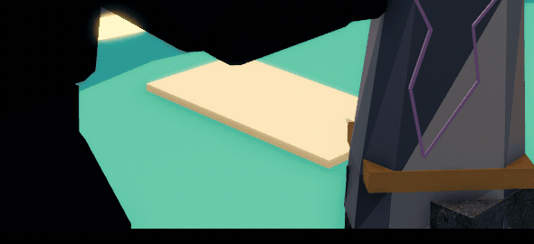

# Intro cutscene feedback, 23 November 2026

## Active cut — Gem Hunter and Light the path

| Direction | Implementation |
| --- | --- |
| Remove the civilization time-lapse, tree regrowth and construction scenes. Show the passage of millions of years through the location itself. | A fork of hot mineral in the impact rock cuts directly to the same weathered shape in the completed mine’s east pier at 19.50 s. The working portal and harbor establish where it is. A brief time caption follows the match. |
| Give camera moves a purpose. Preserve the expressive meteor and blast, use selective long lenses and let the avatar lead into play. | After the blast, a wide holds on the basin. A lateral 23° shot links the eras. A view over the player’s shoulder leads to a reverse on their face at the existing spawn. The light later reaches the buried gem, and the player takes control facing the mine. |
| Carry sound out of the crater without an abrupt score entrance or avatar footsteps. | The ancient mineral rings into a modern pick strike at 19.50 s. Harbor sound opens out on the wide at 20.29 s. The theme enters on the player’s face at 22.00 s. Avatar movement sounds stay muted during the intro. |
| Give the friends’ rooms the detail and pacing of the Rubik’s Cube TV scene. | The bedroom phone, living-room TV and group at the computer share 23.50–30.50 s. Each room shows a reaction, and the final screen takes us back to the player’s workbench. |
| Remove the spike inside the emerald ore and give the Gem Hunter background more artwork. | At 32.13 s the square ore opens around a single step-cut emerald. At 35.42 s the title glass shows a winding tower, mine galleries and the gem’s cutting diagram around the player. |
| Make the button sink under the press and trail like the drawing. Let the guide enter first and visibly touch the gem. | From 41.50 s the press drives the cap into its socket. Three fading outlines track its rebound. The camera pauses outside as the light crosses the sill. At 49.46 s it touches the buried crystal and lights the facets and cave walls. |
| Test the full sequence in Studio and review it with the sound. | Both local place files passed the cinematic and button tests. Two Studio players resumed mining. The archived 720p Studio recording includes the first half-second of gameplay. It played through at normal speed with stereo enabled. Comparison with the Studio mix found zero sample offset at nine points, including the era change, beacon strike and handoff. |

The restored cut uses the original story, shot timings and title artwork with the later avatar stability fix. A fresh Studio capture showed the player's name on the Gem Hunter card, accepted Space on frame 1010 and struck the seal on frame 1018. Control returned to the normal camera and HUD. A full underground replay and an immediate second replay in a 90-block shaft showed zero root travel or drift on held poses.

The first 384 decoded video frames and 705,600 stereo sample pairs match the previously approved opening. Both Studio places passed the cinematic and button tests, including native R6 and R15 checks. One concurrent multiplayer run missed the timing check on the modern mine's pick sound. On a standalone rerun, the sound and beacon checks passed and both players completed the mining loop.

[Watch the original Gem Hunter recording](Where-the-Stars-Took-Root-Current.mp4)

## Archived field-sample edit

| Direction | What changed |
| --- | --- |
| Preserve the approved meteor, impact, destruction, shockwave, timing, lighting, music and effects. | The first editable exposure is frame 384, at exactly 16 seconds. The camera stays offshore through frame 383. |
| Replace the push into the rock and the sudden interior cut. Establish the present-day island and make the time jump clear. | A steady view sets the ancient scar below the ridge. The next shot sees the same headland and shoreline from farther out in daylight. The mine entrance and settled harbor are visible before the player appears in close-up. |
| Attach the pick properly and improve anticipation, contact and recovery. | The previous worker aimed a separately positioned pick at a world target. The player's own equipped pick now stays on its original palm weld. The player braces, shifts weight, strikes and recovers. The actual steel beak meets the split plane on frame 570. |
| Give the player the most important action. Remove the artificial cart arrival and keep the story simple. | The player makes the discovery. They pick up the flake with their free hand, roll it toward the light, see the violet inclusion and return it to the bench. Both split faces come from one fitted rock. The walk to spawn ends with their gaze on the mine. |
| Give objects a purpose in the game and preserve access to spawning, mining, selling and upgrading. | The permanent bench sits outside the spawn compass and its central walkway. Its core trays and field notebook serve a working survey station. In play, the station opens the existing Ore Index. |
| Keep the actual dressed avatar stable across first visits, replays, rig types, proportions and accessories. | One client-side performance rig drives the body, clothing, player equipment and held flake. The live character retains its own location and gameplay state. Deep replays return to the starting shaft. |
| Give the modern scenes stronger framing, camera motivation and sound. | A coastal wide precedes the workbench profile, the pick strike, the exposed rock and the player's reaction. The camera widens for the walk. Recorded shoreline ambience, an exterior rock strike, pebbles on wood and a short pitched glint replace the gallery and cart sounds. |
| Review the complete film in Studio and check desktop, mobile, skip, replay, deep-mine playback, multiplayer and onboarding. | Native recording and repeatable Studio checks cover the locked opening, exposure-by-exposure tool grip, sample pickup and return, character stability, map interaction and the return to normal play. |

**Studio verification.** The first 384 freshly captured exposures matched the previous build across 21 camera, lighting, meteor and impact measurements. The delivered movie retains the previous approved footage through frame 383. The decoded MP4 matched every opening pixel and all 705,600 stereo sample pairs through 16.000 seconds.

The player's own gameplay pick was checked through the complete stroke with native R6 and R15 rigs at 0.68×, 1× and 1.48× size. The largest measured tip-to-contact distance was below 0.00002 studs. At pickup and set-down, the palm and display socket met within 0.00001 studs. Both local places passed the cinematic tests. In the two-client test, both miners opened the actual Ore Index at the bench and completed a 40-block mining, selling and upgrading loop.

Portrait review caught a separate R6 grip issue. The stock hand attachment aimed the handle up the inside of the arm. The corrected grip keeps the tape on the palm and projects the steel 1.49 studs forward. The native rig test now checks both palm contact and clearance throughout the stroke. The landscape camera leaves the fully raised steel 27 pixels below the matte in the 720p capture. [Compare the R6 swing in three Studio frames](R6-pick-grip.jpg)

First-time playback, spawn replay, consecutive underground replays, three skip points and interrupted respawn released the camera and restored the HUD. Two replays started in a freshly excavated shaft 90 blocks deep, with the live character over 540 studs below the performance. The head and hand stayed stationary on held exposures, and the unanchored gameplay root stayed on its mark through the handoff.

The 35-second cinematic and the next half-second of gameplay played through at normal speed on Windows. A second encode preserved more of the brief stereo pick strike. The finished movie was checked against captured stereo output and a simulated 280–6,500 Hz mono phone speaker. The strike, flake landing and glint all remained distinct in that simulation. Phone framing was tested in Studio's device emulator.

[Watch the field-sample recording with sound](Where-the-Stars-Took-Root-Field-Sample.mp4) · [See six Studio frames](Field-sample-sequence.jpg)

## Earlier gallery and cart edit

| Feedback | Change in the film |
| --- | --- |
| Keep the shooting star, meteor, collision, island destruction and shockwave locked. | The offshore camera holds through frame 383. The new push toward the crater starts at frame 384, exactly 16 seconds in. |
| Drop the object held in place while its surroundings change. Make the passage of time clear. | The camera approaches the smoking scar until the view falls into darkness. Lamplight and the sound of the working gallery introduce a wider shot of timber supports, a miner, a cart and an exposed stone. A short “Millions of years later” caption locates the cut. |
| Replace the toy miner. Make the discovery visible and believable, and keep the celestial source mysterious. | A native Roblox R6 prospector braces the pick, strikes a small mineral already seated in a pocket in the wall and looks down as it drops into the pan. The miner lifts a safety lamp toward the way out. A violet reflection links the chip to the impact. |
| Let the actual player take part. Give the surface shots a clear direction and purpose. | An approaching ore load catches the player mid-step at the spawn plaza. The reverse shows the player's face, the specimen and the hand that stops at its flash. Their gaze and next steps lead to the mine. The load continues toward the quay behind the final camera. |
| Investigate twitching, accessories, competing animations, underground scaling, cleanup and the gameplay handoff. | Every surface shot uses a local copy of the actual dressed player. Each body part and equipped item gets one pose per exposure. Gameplay animation stays with the live character. The surface performance resolves into the live pose and camera at spawn. An underground replay returns to the viewer's starting shaft and scale. |
| Audit the second-half music, levels, spatial sound, action sync and replay cleanup. | A falling-stone tail and mineral tone bridge the eras. The strike uses steel on rock. The pan catches the specimen, the lamp bail rattles as it settles, and the cart rolls in and brakes. The mineral answers on the surface and a short rising phrase accompanies the player's look. The player's ordinary character sounds return with the harbor ambience. |
| Check first visit, repeat viewing, skip, interrupted respawn, multiplayer, avatar variants and mobile presentation. | The test suite exercises the normal onboarding path, independent player cameras, R6 and R15 socket poses, equipped items, scaling, and cleanup. The replay check also uses an excavated shaft 17 cells below the surface. |

### Playback review

The previous version reproduced an intermittent underground twitch on the second consecutive replay. Tracking the head and hand relative to the avatar's root measured **up to 0.93 studs of drift and 31.17° of hand rotation during held exposures**. The previous remote rig still had 31 unanchored parts. At spawn the cutscene and two playing animation tracks also shared the live skeleton.

The updated build measured **zero hand drift and zero angular drift** during held exposures on first visit, spawn replay, two consecutive underground replays and a replay after respawn. The live root stayed on its mark. During development, a separate test caught Roblox turning torso collisions back on when the staged humanoid entered the scene. Keeping the performance rig noncollidable also eliminated a 9.9-stud displacement at the final handoff.

These pictures come from an unanchored player in the same excavated shaft in both builds. By 29.38 s the old avatar has sunk below the cart. In the updated build the avatar, pick and accessories stay together through the turn and final shoulder shot. [Compare the underground replays](Avatar-replay-comparison.jpg)

Studio tests also exercised Skip during the opening, gallery and player shots, respawn during the performance, newly equipped accessories, and Roblox's native R6 and R15 rigs at different scales. The portrait pass used a 390 × 844 viewport.

The two-player run exposed a compact layout issue after control returned. At 320 × 615, native chat could move the location title over the wallet and buttons. The HUD now reserves their space. The original two-client test passed after the fix, with each player mining 40 blocks, selling ore and returning to the entrance.

The continuous Studio pass matched the previous build on all 21 recorded opening values for each of the first 384 exposures. The finished movie retains the approved encoded opening. A separate decode confirmed identical pixels and identical audio for the first 705,600 samples in each stereo channel. The runtime is 35 seconds, followed by half a second of the real gameplay handoff.

The final MP4 played to the restored HUD at normal speed on the Windows audio output. The decoded stereo aligned to the release mix at zero sample offset across 15 checks. In a 280–6,500 Hz mono phone-speaker simulation, the pick and the pan rose 10.8 dB and 22.8 dB above their preceding ambience. Both steps and the harbor tail remained audible in the captured signal. The phone check used a simulated speaker response.

[See the gallery replay comparison](Avatar-replay-comparison.jpg)

## Previous 35-second intro

| Direction | Revised cut |
| --- | --- |
| Lock the meteor approach, collision, destruction and shockwave, including the sound. | The first editable exposure is frame 384 at 16.000 s. Frame 383 is still the offshore breaker camera. |
| Connect the buried celestial material to the working mine without showing the development of civilization or revealing the source. | The glowing fork in the crater matches the same fork in worked rock. A pick breaks off a splinter. The splinter repeats the fork’s light when it reaches the surface. |
| Replace the broadcast, competition, award, selection and guided dive with a short mining story. | Follow the mineral into an ore cart. Match the loaded cart from the underground gallery into the harbor as its wheels continue turning. |
| Give the actual player a reason to investigate and preserve the normal start of play. | The cart pulls up at spawn. The player leans closer, checks their reach as the ore glints, and looks toward the working mine. Their eyeline becomes the final view and the existing onboarding resumes. |
| Redesign the second half’s sound and keep the pace close to 30–40 seconds. | The impact resonance returns on the split and on the splinter. The wheels carry the sound outside, and a short horn phrase accompanies the player looking up. The intro runs 35 seconds. |

### Studio review

The old and rebuilt places were run separately through frames 0–383. At every exposure, all 21 recorded values agreed, including camera transform and focus, lens, simulation time, meteor pose, debris, breaker and light state. Fresh rasterizations averaged 0.136 levels of RGB difference on a 0–255 scale. The sound comparison covered all 37 cues starting before 16.000 s and the three tails continuing beyond it.

The previous recording used the approved opening footage before that boundary. A decode of the two MP4s confirmed identical pixels on all 384 opening frames and identical PCM on the first 705,600 samples of each stereo channel. The new cut runs 840 frames at 24 fps, followed by 12 frames of gameplay.

In the first surface take the hand rose beside the avatar’s face and the lower matte hid the ore. The revised shot keeps the face, reaching hand and responding mineral in one composition. A separate iPhone portrait pass exposed a clipped head at the end of the cart pullback. The revised portrait framing keeps both the head and the specimen inside the picture while preserving the cart match.

Both local places passed the cinematic tests. Studio playtests exercised interrupted respawn, Skip, replay, the transition back to the Dig waypoint and two players mining independently. A concurrent run reported a compact HUD overlap at 320 × 615. The same two-client test passed on rerun, including that layout check, with both players mining 40 blocks.

## Previous 70-second intro

The TV reference is the Rubik’s Cube recording `2026-11-21 15-48-03.mp4`. Times in this section are measured from the start of the earlier 70-second edit.

| Scene | Feedback | What changed |
| --- | --- | --- |
| Crater and music, 0:16–0:27 | Keep moving into the crater, fade out, then cut back in with things already moving. Smooth the entry of the music. Check the apparent avatar walking and jumping. | The camera pushes toward the glowing seam and fades to black. After two black frames, the regrown cove cuts in at 0:23.04 with the camera already tracking. Reduced motion has a softer return. A bowed phrase starts at 0:20.55 and carries across the cut. The old soundtrack used Roblox movement samples. Those cues were replaced, and character sounds are muted for the film and restored on exit. |
| Friends at home, 0:39.13–0:46.13 | Study the Rubik’s Cube film. Give each home more detail and make the phone, TV and computer shots a short compilation that flows. | The Rubik’s Cube TV sequence at 0:27–0:36 informed the shoulder view, reverse on the viewer’s face and move through the screen. The bedroom now has a collector’s shelf. The child leans toward the living-room TV, and the friends at the computer react to one another before the monitor fills the frame. The three homes share seven seconds. |
| Emerald ore, 0:47.75–0:51.04 | Remove the spiky shape inside the ore. Keep the square block and make the emerald read clearly. | Two square ore halves open around a single step-cut emerald. Smooth cavities frame its broad octagonal face and polished diagonal reflection. |
| Gem Hunter, 0:51.04–0:54.04 | Give the glass background more artwork and detail. | A winding tower and underground galleries are etched into one side of the glass. A cutting diagram of the emerald balances the other side and leaves the miner’s name legible. |
| Beacon button, available from 0:57.13 | Make the button sink as soon as the player presses it. Give it expressive movement with successively fainter outlines like the sketch. | The cap squashes down into a fixed socket. A short tap rebounds immediately after compression, and a held input keeps it depressed a little longer. Three outlines follow the cap through the rebound and fade as it settles. Reduced motion uses a stationary confirmation. |
| Mine and gem, 0:58–1:07 depending on the press | Keep the light ahead. Slow down outside and let it enter first, then dive after it. Give the gem an effect when the light touches it. | The camera eases outside the arch as the light crosses the sill. The light also drops into the shaft first. At 1:05.08 it touches the front facet of Starfall. A chime sounds, the neighboring facets light up in sequence, and violet light reaches the cave walls. |

Studio checks cover an early press, a later press and the automatic swing. In all three the guide stays closer to the gem than the camera throughout the chase. The prompt and cinematic tests passed in both local place files. A two-player playtest also checked skipping, replay and the return to mining.

## First pass on the supplied recording

The first column follows the supplied 2:44 playtest recording, including its replay. The last column records the first 76-second edit.

| Recording | Feedback | First edit |
| --- | --- | --- |
| 0:06–0:33 | Give the end of the blast a second, smaller explosion when the debris reaches the viewer. | At 0:13.63 a short, quieter explosion follows the wave as the shale passes the camera. It uses the effects volume setting. |
| 0:33–0:54 | Keep the crater visible throughout the time-lapse. Make the impact basin larger and more dramatic, with the surrounding hills visibly slanted by the strike, especially just after impact. Keep regrowth and new hills clear of the opening. | From the impact through the last historical wide shot, the banks slope away from a wider rim. The crater floor stays exposed as trees return and the quarry grows. The mine roof appears at the present-day cut. |
| 0:54–1:00 | Make the mining shown in the film blockier so it looks like the game players enter. | The historical hoist carries cubical rocks. The workbench demonstration uses the emerald pattern from the playable mine. |
| 1:01–1:29 | Make the people across the film recognizable Roblox characters. Cast the viewer's Roblox friends in the audience when possible. | At 0:27 the boat crew and early workers use classic six-part Roblox rigs. At 0:39 the broadcast audience uses Roblox avatars, including friends whose appearances load in time. Local actors fill the remaining seats. |
| 1:29–1:58 | Give the audience several unhurried shots. Show someone in a dark bedroom watching on their phone, a kid watching the living-room TV, and a group of friends watching a computer together at home. Give each room enough screen time to read. | 0:39.13–0:43.13 is the bedroom, 0:43.13–0:47.13 is the living room, and 0:47.13–0:52.13 is the computer room. The same player and workbench stay on the screens throughout. |
| 1:58–2:11 | The specimen opening around the emerald looks like a coconut. Use a block for the mining demonstration and make the emerald read clearly. | At 0:53.75 the pick opens a square ore block. Its two halves fall to either side, leaving the green emerald standing on the bench. |
| 2:11–2:37 | Give the player and **Gem Hunter** title a cleaner, more modern, glassy background. | At 0:57.04 the harbor gives way to blue-green glass with lit edges behind the player, their name and the **Gem Hunter** title. |
| Button sketch and chat | Show a crisp moving button with a short vertical trail of progressively fainter rounded outlines. The control should respond immediately. | At 1:03.13 the **Light the path** prompt rises with a light trail, then settles. Press Space, gamepad X or tap for a second lift with three more distinct outlines. Reduced motion gives a stationary confirmation. |

Both local builds passed the Studio cinematic and button tests. A full-speed playtest checked the three viewing rooms, the debris sound, a Space press and the handoff to the gameplay camera. A signed-in session loaded a friend's equipped avatar, and a separate check exercised the local cast with friend appearances unavailable.
