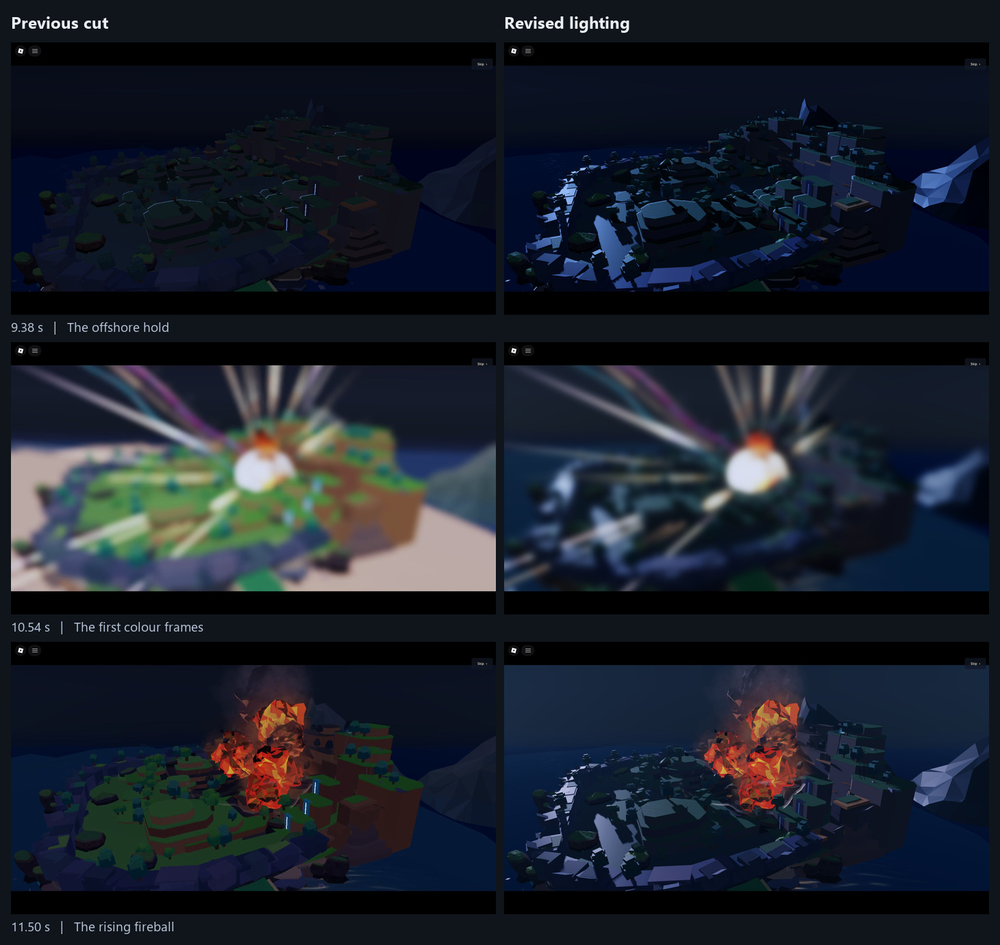
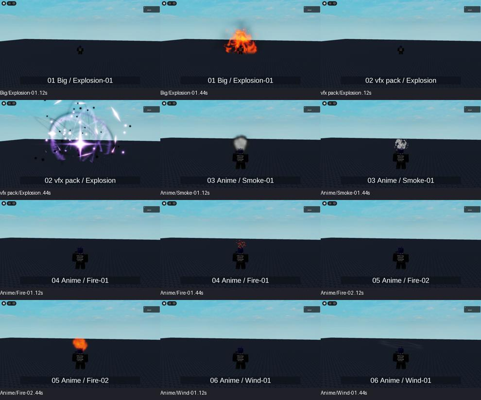
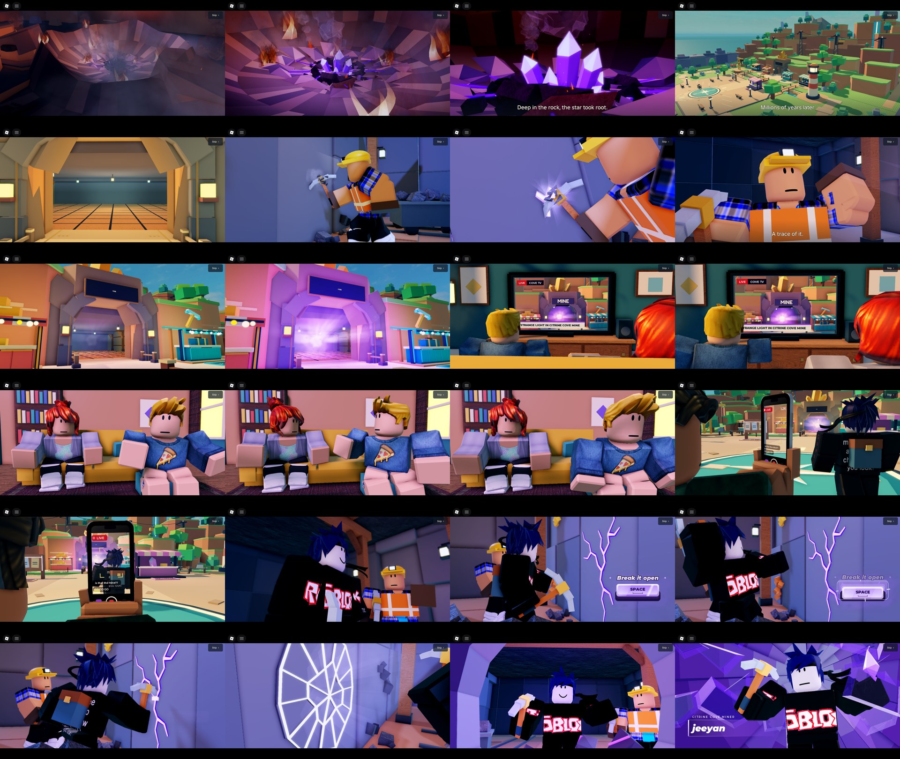

# Where the Stars Took Root

The star that fell took root. A miner opens its vein, the cove watches on a screen, and the player walks toward it. Their strike is their introduction, and the light they free runs home into the mine. [Second-half shot list and tools](Second-half.md)

The last offshore picture is frame 383. Frame 384, at 16.000 seconds on the 24 fps exposure sheet, is the first camera position inside the crater sequence. The preceding meteor, destruction, lighting and soundtrack use the approved opening.

| Time | Picture | Sound |
| --- | --- | --- |
| 0–2.25 s | A small meteor crosses the gap beside the headland. Its hot nose turns and briefly brightens twice. A tapered trail lags behind it and the broken reflection follows across the tide. | Surf and a high overtone establish the quiet cove. |
| 2.25–4.00 s | The meteor crosses a 37° lens on a descending diagonal. Broken compression rings and scraps of crust trail behind. | Air rush gathers around the high note. |
| 4.00–8.75 s | Hold close enough to see the violet crystal glowing inside its dark shell. The camera swings 180° past the nose and over the shoulder. The coastline enters on the right, then the meteor and its destination share the frame. The camera is still moving when we cut. | The crystal strains above the growing rush of air. |
| 8.75–10.00 s | Hold offshore. A faint blue light catches the headland from one side. The tree crowns cast long shadows across the terraces. The horizon trembles. After 27 empty exposures, the meteor tears diagonally across the next three, leaving cyan and magenta filaments around an incandescent core. Its light reaches the water and headland. | Pressure builds under the empty sky. The air tears just before contact. |
| 10.00–13.50 s | Hold the same offshore view for the dry puncture, one moonlit exposure and the pin of light. The fireball opens three frames after ground contact. Violet and copper streak the terraces, and a segmented circle closes around the starburst on frame 246. | Contact cracks. The main report lands three frames later. The crater wall collapses and the echo rolls back across the water. |
| 13.50–16.00 s | A clean view of the erupting island precedes the return wave. The old ivory-and-charcoal crest sweeps across the bottom of two full-color views of the burning island. Color splits along the trees, shore and airborne fragments. | The crest brings a rush of air. A smaller, short explosion follows three frames later as debris reaches the camera. |
| 16.00–21.08 s | One crane goes over the rim and down to the crystal in the bottom of the bowl. A low move round it as its light burns out. | Wind over the rim, cooling rock, a low held tone that dies with the light. |
| 21.08–25.58 s | The present-day island from the mark the impact was watched from, then the lens runs under the sign and into the mine. | Silence, then the sea and the first bar of the score. |
| 25.58–29.92 s | The miner swings twice. The vein opens on frame 674. Light rises on their face. | Steel and rock, then the crystal's tone. |
| 29.92–31.67 s | Outside, violet light builds in the doorway and spills over the stone and the paving. | The ground, then the crystal's chord rising. The score steps back. |
| 31.67–35.17 s | Two siblings see it on the news. They check with each other and lean in. | The tone, small, through a television. |
| 35.17–37.17 s | A witness films the player on a phone, walking toward the mine. | Shore and footsteps. |
| 37.17–41.92 s | The player reaches the face. **Break it open** is live from 39.25 s. | The gallery, the crystal humming behind the rock. The press has its own sound. |
| 41.92–43.88 s | The blow on frame 1006. The fracture runs, the slabs fall and the pocket lights the player. | The break, then fragments. The theme enters on the contact. |
| 43.88–46.83 s | The violet glass reveal with the player's own avatar and name. | Theme and light on the facets. |
| 46.83–52.92 s | They walk out of the mine, hear it and turn back. The camera becomes the gameplay camera. | Something moves below. The last hit of the score lands before play. |

## Tune the opening in Studio

The opening is a live scene on each player's device. `ExposureSheet` counts 24 frames per second. On each frame `Film` positions the camera, draws the star or island, and applies the shot lighting. The historical island is a private set under the local camera. Later shots use the playable mine and the player's avatar. When the film ends or the player skips, the client restores the gameplay camera and lighting.

### Preview a shot

1. In Studio **Edit** mode, open the **Command Bar** and enter `workspace:SetAttribute("StarfallPreviewFrame", 225)`. Press **Play**. Frame 225 is the quiet offshore shot at 9.375 seconds.
2. In the **Client** view, select **Workspace → StarfallPreview** in Explorer. Open **Properties → Attributes**. Change **Frame** to inspect a different instant. Try **30** for the shooting star, **204** for the view behind the meteor, **225** for tree shadows before contact, **253** for the flash subsiding, or **276** for the fire lighting the crater.
3. Adjust **Exposure** for overall brightness. **ShadowFill** sets the color in the unlit ground and **RimStrength** controls how much light catches the edges. **RimColor** tints that light and **SkyColor** changes the sky. Start with the rim strength if the ledges stand out too much. Check the sky and the island on the same frame as you work.
4. Check **PrintSettings** and copy the block starting with `return table.freeze({` from Studio’s **Output** window. Set **Frame** to **-1** to watch the film from the beginning with these settings and sound, or use **Skip** to enter gameplay.



### Save the look

The permanent settings are in **StarterPlayer → StarterPlayerScripts → Client → Starfall → NightLook**. After stopping Play, paste the exported block into that ModuleScript in the place you want to save. For this Rojo project, paste it into `src/client/Starfall/NightLook.luau` on disk and let Rojo sync it, or rebuild the place. In a standalone Studio place, save the place after editing the ModuleScript. Play again to check the saved result. To return a regular Studio place to its usual Play behavior, run `workspace:SetAttribute("StarfallPreviewFrame", nil)` in Edit mode.

`Tide.luau` controls the first 54 frames, including the star and its reflection. `Daylight.luau` applies the changes in light over time. `Moonlight.luau` lights the historical coast from offshore. The tree silhouettes and the shapes of the light on the shelf edges were baked from the island geometry. The rebuild command for a changed coastline is under **Lighting and wave travel**.

In the offshore shot, `Daylight.luau` sets `Lighting.ClockTime` to **17.15** and `GeographicLatitude` to **33.9**. This gives the trees a low, directional source that lines up with their baked shadows. The dark sky and blue fill make it read as moonlight. At ignition, the rising fire and two crater banks supply the warm light. The shadowed foreground stays blue. The historical lighting gives way to daylight with the modern mine cut at frame **468**.

## Footage studies

The earlier trial cut studied how a silhouette reads against a title. In the *Persona 5* protagonist trailer the character’s outline registers across the red identity card at 11.3–13.6 seconds. In the *Tekken 8* Jin introduction the extended fist and face stay in position as the name arrives around 28.7 seconds. [Persona 5 protagonist trailer](https://www.youtube.com/watch?v=V7d5XJLmwBk) · [Tekken 8 Jin trailer](https://www.youtube.com/watch?v=vkJQZ2Cz9-s)


- At 34:26 the artist discusses using one or two drawings to mark a single hit. Around 34:42, a narrow white crest cuts through broad charcoal shapes in the *Star Driver* example. Later, the frame-by-frame breakdown distinguishes the point of contact from the wall giving way. The collision keeps the coast and horizon registered while the silhouette, shutter and negative break up the strike. At the second impact the moving water crest cuts across the camera, followed by an exposure of the ejecta behind it. [Impact-frame breakdown, starting at 34:18](https://www.youtube.com/watch?v=ZMOg_QEOF5w&t=2058s)
- Around 0:14 the cut travels from a dark ring to fractured silhouettes, each with a different center of attention. The collision and the offshore breaker have separate compositions. [Roblox impact reference](https://www.youtube.com/watch?v=LZuSLM6LumU&t=14s)
- The warm edge survives changes of scale against a cool center. Amber pressure and violet rock carry that color relationship through the meteor passes. [Color and camera reference](https://www.youtube.com/watch?v=2iqlLWFvRv0)
- Around 0:24 the held dark street, sudden lateral light and lingering dust occupy different amounts of screen time. Here the distant observer gets time to register the light before the front arrives. [Blast reference](https://www.youtube.com/watch?v=MobWshN54vo&t=24s)
- The weight of the action reads in the held preparation, extension and recovery. The miner lifts the pick from the hip, catches its weight on the shoulder and shifts into the striking stance. [Posing reference](https://www.youtube.com/watch?v=X8L-mP92zcA)
- A close foreground action gives way to a distant view of the arena. The rear chase cuts to an offshore observer before contact. The observer stays in place until the front passes. [Additional action reference](https://www.tiktok.com/@kurousagi93370/video/7464301116105166113)

## Asset production

[Falling Star.blend](<Falling Star.blend>) contains the meteor sculpt and tumble. Export an edited file with the command below.

```sh
blender -b "art/starfall/Falling Star.blend" -P art/starfall/sculpt_star.py -- --export
```

[Pressure Bloom.blend](<Pressure Bloom.blend>) contains the blast volumes and their animation. The bake passes the solid brushes through Studio and packages locally loadable geometry and animation tracks in the place. The expanding ignition core and bundles of jagged tapering rays occupy the same world space as the plume. Each impact exposure pairs a different pose of the three-dimensional rays or pressure crest with its own camera response. Silver and copper exposures retain some of the source color. Hard positives and negatives register the light and coast in black and white. Regenerate the plume and historical island from the project root.

```sh
python art/starfall/bake_plume.py
python art/starfall/carve_faults.py
python art/starfall/bake_cove.py
```

The square trial block opens around the emerald. The glass portrait layers photograph the player's dressed avatar and shouldered pick. The etched title artwork and printed dispatch carry the trial into the interactive beacon shot.

[Flight Layout.blend](<Flight Layout.blend>) contains the line of fall, the pressure buffets and the entry cameras. The edit uses 24 picture exposures per second. Each exposure samples camera, shell, sky, plume, debris, the two island sets, captions and the avatar performance together. Between exposures the picture holds while audio plays continuously. Playback follows elapsed time, so a slower device can miss exposures without lengthening the film. The gameplay camera resumes its normal update rate when the shot ends.

```sh
blender -b "art/starfall/Flight Layout.blend" -P art/starfall/stage_entry.py -- --export
```

## Lighting and wave travel

The moon is outside the picture. A low blue key defines the headland, with deep shadow underneath the terrace lips and the trees. The water catches a little of the same light. The cast shapes come from the actual historical island geometry and stay legible on lower graphics settings. Running `python art/starfall/bake_moonlight.py` rebuilds them after a change to the historical island. The distant shooting star casts a moving reflection of its own. On the three terminal descent frames, the terraces and broken water highlights pick up violet, amber and then near-white light. After impact, reflected fire follows the rising plume. Inland, blue spotlights rake the rock while pockets of fire light the underside of the drifting soot. Foreground dust crosses the lens at different depths. As the ash settles, the elevated camera holds focus on the basin. The shot lenses use Roblox's vertical field of view and are fitted again when the viewport changes shape. [Roblox lighting](https://create.roblox.com/docs/environment/lighting) · [Post-processing](https://create.roblox.com/docs/environment/post-processing-effects) · [Camera field of view](https://create.roblox.com/docs/reference/engine/classes/Camera#FieldOfView)

In an isolated Studio Play test, a LocalScript could read the place's Soft lighting style. Studio reserves changes to that style for authoring tools. The film animates the local lights, ambient color, shadow softness, diffuse and specular response, exposure and atmosphere within the existing place style. Testing the suggested negative dimensions clamped a Part to 0.001 studs on each axis. A SpecialMesh accepted the signed scale, which controls mesh geometry. The depth cues in the film come from individual layers of rock, vapor and light in the scene. [Roblox Lighting API](https://create.roblox.com/docs/reference/engine/classes/Lighting)

The ancient basin sits under the modern mine. The fork in the hot rock cuts to a weathered fork in the modern mine entrance. The working cove opens up beyond it. Underground replays can load a finished replica of the playable harbor while the real area streams. The pressure front travels from the fault across measured island cross sections. At 27 outcrops, 81 fitted capstones part from their footings in successive groups, rotate through ballistic arcs and fall onto the local slopes or into the sea. Eight coastal stacks break as the front leaves the land. Dust follows the lift. Fires, ash, toppled vegetation and displaced rock stay in the private historical set until the cut to the present. Touch devices and lower graphics settings use fewer moving reflectors and dust layers. Reduced Motion suppresses the threshold and shutter exposures, flyby smear, lens blur and camera recoil and limits peak illumination.

## Toolbox evaluation

The Euphoric Games Community VFX pack was isolated in a disposable Studio place. An exact-ID Toolbox search returned 112672322113504. Inspection of the 121 roots found 281 particle emitters, 21 beams, 45 decals, 11 SpecialMeshes, one trail, one sound and zero script containers. Six emitter-only previews included Big/Explosion-01, Explosion, Anime/Smoke-01, Fire-01, Fire-02 and Wind-01. Big/Explosion-01 gave a compact orange puff. Explosion gave a violet flare with rings that obscured the island silhouette. The island-scale blast in the film uses the original Blender volume. [Creator Store listing](https://create.roblox.com/store/asset/112672322113504/VFX-PACK)



The small sparks above the secondary fires and the dust along the meteor use the FireSpecs1 emitter's texture from Anime/Fire-01. Roblox identifies image 11187840108 as Images/DotGlow by Yuruzuu. A separate Studio session successfully preloaded the image. The film positions and fades those textured motes on each picture exposure. All main fire, smoke and pressure geometry is bundled with the place. [Roblox Creator Store asset permissions](https://create.roblox.com/docs/production/creator-store)

## Current Studio recording

The film runs 1,270 exposures (52.9 s). Pictures are Studio captures of every exposure, with a Space press at frame 967, so the recording is 51.8 s. The stereo track is a real-time Play session of the same build. [Watch the current cut with sound](Where-the-Stars-Took-Root-Current.mp4) · 

## Previous Studio recording

This earlier cut records the trial and beacon storyline. The restored version uses the shorter Gem Hunter edit and its press-and-rebound control.

Studio supplied one 1920 × 1080 picture for each exposure. The stereo track comes from a real-time Play session with the interactive strike on the same frame. The film runs for 1,562 exposures at 24 fps (65.08 s), followed by half a second of gameplay. The trial blow lands at 42.83 s. In this take the player presses Space and strikes the route beacon at 54.125 s. The pulse reaches the mine threshold at 57.67 s and flares on the shaft wall at 58.96 s. [Watch the film](Where-the-Stars-Took-Root.mp4)

Frames 237–239 carry the terminal descent. Contact is frame 240 at 10.000 s. Frame 241 returns to ordinary moonlight and frame 242 tightens down to a pin. The main eruption opens on frame 243 at 10.125 s. The broken circle surrounds ignition on frame 246. Frame 247 goes white and the following exposures reverse and change the ray shapes. In the second sequence, frame 323 gives one ordinary view of the oncoming water. The original torn white crest crosses the full-color eruption on frames 324 and 325. Frame 326 goes black. The final printed exposure is frame 328, two frames earlier than the previous edit. [Frames from the Studio recording](Starfall-frames.jpg)

The recorded score uses 2nd Foundation Music’s *The Final Push 30B* from APM Music. Drums build under the settlement and brass carries the challenge into the harbor. The sound of the pick hitting the beacon follows the player’s input. If the track is unavailable, the client plays a locally voiced adventure score. The music and sound effects groups follow the player's saved mixer settings. [Creator Store track](https://create.roblox.com/store/asset/1848015198) · [Roblox licensed music in recordings](https://en.help.roblox.com/hc/en-us/articles/360038525351-Using-Licensed-Music-in-Videos)

In that earlier version, the player performed the closing shot with their own character. For an underground replay, the client stages a copy of the dressed character at the compass and restores the original view. The printed commission carries the player’s Roblox display name. Other players, their equipment and their companions stay out of the shot on the viewer’s client, including when someone joins or respawns. The black bars withdraw as the camera returns to the player.

Studio checks cover interrupted respawn, Skip, independent playback for two players, the player’s interactive strike, the route lights and the return to the Dig waypoint.
